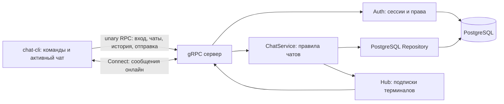

# Как работает приложение

## Компоненты

`cmd/chat` — сервер, `cmd/chat-cli` — клиент. Сервер одновременно регистрирует `AuthService`, `UserService` и `ChatService` из `api/grpc/chat_v1.proto`.

| Каталог | Ответственность |
| --- | --- |
| `core/domain` | Пользователь, группа/диалог, сообщение, ограничения |
| `internal/auth` | Хеширование паролей, сессии, gRPC interceptors |
| `internal/server/service` | Создание чатов, проверка участия, отправка и история |
| `internal/server/ports` | Интерфейсы хранилища и доставки |
| `internal/server/adapters/outbound/postgres` | Транзакции чатов, участников и сообщений |
| `internal/server/adapters/outbound/hub` | Подписки активных подключений |
| `internal/server/adapters/inbound/grpc` | Преобразование protobuf, статусы ошибок, стрим |
| `internal/client` | Ранее написанный серверный CRUD профилей; название историческое |
| `internal/cli` | Команды клиента, навигация, история, уведомления, сессия на диске |
| `migrations` | Версионируемая SQL-схема |
| `gen/grpc/chat_v1` | Сгенерированный gRPC-код |

## Вход

1. `register` проверяет имя: 3–32 латинских символа в нижнем регистре, цифры и `_`, первый символ — буква. Создаёт профиль и пароль в одной транзакции с сессией.
2. Пароль хранится как PBKDF2-HMAC-SHA256: случайная соль 16 байт, 600 000 итераций, ключ 32 байта. Проверка использует сравнение за постоянное время.
3. Сервер выдаёт случайный токен 32 байта с временем жизни 30 дней. В БД лежит SHA-256 токена; открытый токен хранится только в файле клиента.
4. Каждый защищённый unary RPC и открытие стрима передают `authorization: Bearer <token>`. Interceptor извлекает пользователя из БД и записывает UUID в контекст. Полям отправителя со стороны клиента сервер не доверяет.
5. `logout` удаляет конкретную сессию. Остальные терминалы с другим входом сохраняют доступ. Активные стримы перепроверяют сессию каждые 15 секунд; срок действия и отзыв применяются и к простаивающим подключениям.

Регистрация и вход доступны без сессии. Просматривать пользователей можно после входа. Из старого CRUD разрешено менять только собственный профиль, кроме имени входа; создание аккаунта делается через `Register`. Удаление профиля и загрузка аватара пока не реализованы как пользовательские сценарии.

## Группы и личные диалоги

Создатель группы получает роль `owner`, приглашённые — `participant`. Участник читает и пишет; владелец добавляет и удаляет участников. Модель и SQL также знают роль `admin`, но выдача этой роли в MVP не реализована.

`Chat.is_private` в protobuf и БД обозначает **личный диалог**, а не настройку публичности группы. Все группы доступны только их участникам. Каталога публичных групп и свободного вступления сейчас нет.

Личный диалог содержит двух разных пользователей. Их UUID сортируются и образуют `direct_key`, защищённый уникальным ограничением PostgreSQL. При двух одновременных `/dm` сервер возвращает одну запись через `INSERT ... ON CONFLICT`. Добавлять или удалять участников личного диалога нельзя.

Чаты создаются вместе с участниками в транзакции. Если указан несуществующий пользователь, группа целиком откатывается. Изменения состава блокируют строку чата. Сохранение сообщения и чтение истории повторно проверяют участие в своей транзакции, поэтому удалённый участник не может обойти проверку гонкой между запросами.

## Отправка сообщения

1. Клиент отправляет `SendMessage(chat_id, content)`; пользователь берётся из сессии.
2. Сервис проверяет чат, участие и содержимое. Пробелы по краям убираются; пустой текст и больше 4096 символов отклоняются.
3. Репозиторий записывает сообщение в PostgreSQL. Только после успешной записи сервис передаёт его в Hub.
4. Hub рассылает событие всем активным терминалам участников, включая терминалы автора. `SendMessage` также возвращает подтверждение с ID и серверным временем.
5. Клиент убирает повторную отрисовку ответа и события по ID. Для открытого чата показывает текст; для остальных увеличивает локальный счётчик и показывает уведомление.

Клиент использует unary RPC для подтверждённой отправки и `Connect` для приёма. Контракт `Connect` двунаправленный: отправка через него тоже поддерживается; неверное сообщение завершает стрим явной gRPC-ошибкой.

Каждый терминал имеет отдельную подписку на 100 событий. Переполнение завершает стрим с `ResourceExhausted`: клиент переподключается и перечитывает историю. Перед отправкой события обработчик ещё раз проверяет доступ получателя, чтобы не выдавать очередь удалённому участнику. Чтение и запись стрима разделены, а `Send` вызывает ровно одна горутина.

Источником истории служит PostgreSQL. Очередь Hub находится в памяти: если сервер завершится между записью и рассылкой, сообщение останется в истории, но онлайн-событие может не прийти. Автоматической повторной отправки нет, так как запрос пока не содержит ключа идемпотентности.

## История и переключение

`/chats` загружает все страницы списка доступных чатов. `/open` меняет активный чат в клиенте; переподключаться к серверу для этого не нужно. Один стрим получает сообщения всех чатов пользователя.

История запрашивается с `chat_id`, `limit` и необязательным `before_message_id`. Сервер проверяет, что курсор принадлежит тому же чату. Сортировка использует `(created_at, id)`, поэтому одинаковые временные метки не ломают пагинацию. Возвращаются последние N сообщений перед курсором в порядке от старого к новому. Открытие чата показывает 30 последних; `/history` загружает более раннюю страницу.

Счётчики непрочитанных локальные и сбрасываются при открытии чата. Во время отключения события не накапливаются для клиента. После восстановления соединения обновляется список и последние 30 сообщений активного чата; остальные переписки можно открыть и прочитать из БД.

## Хранение и миграции

- `chat.users`: профиль и необязательный `password_hash`.
- `chat.sessions`: хеш токена, пользователь и срок действия.
- `chat.chats`: название, признак личного диалога, уникальный ключ пары.
- `chat.chat_members`: пользователь, чат, роль, время вступления.
- `chat.messages`: отправитель, текст, чат, серверное время.

Миграция `000002` расширяет исходную схему без удаления профилей, групп и сообщений. Старые профили без пароля не становятся доступными для входа: зарегистрируй новый аккаунт или отдельно разработай безопасную привязку старого профиля. Уникальность имени входа применяется только к аккаунтам с паролем. В старой группе владельцем становится участник с минимальным UUID в текстовой сортировке. Старые личные диалоги не получают `direct_key` автоматически; гарантия отсутствия дублей относится к диалогам, созданным новым приложением.

Локальный запуск использует PostgreSQL через Compose и проброс на loopback. Для внешнего gRPC-адреса сервер требует TLS; CLI проверяет сертификат. Сервер завершает активные RPC до 5 секунд, затем останавливает стримы принудительно.

## Границы текущей версии

Один серверный процесс, приглашения в группы, текстовые сообщения и построчный интерфейс. Постоянные отметки прочтения, полноэкранный TUI, поиск сообщений, вложения, восстановление пароля, ограничения частоты входа и доставка между несколькими серверами — отдельные этапы [roadmap](ROADMAP.md).
